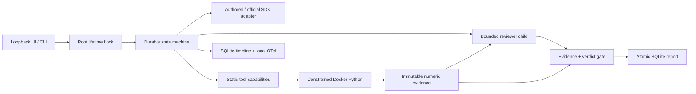

# Durable Agent Workbench

[](https://github.com/IgorFedchenko/durable-agent-workbench/actions/workflows/ci.yml)
[](pyproject.toml)
[](LICENSE)

A local agent workflow that turns a synthetic retail question into isolated Python analysis, immutable evidence, a bounded reviewer and a report with checked numeric citations. Stop a worker and resume its durable state. Inspect every decision, failed attempt and artifact in a local web debugger.

**Default provider responses are AUTHOR-WRITTEN SCRIPTED RECORDINGS.** They are not captured paid-model output or evidence of model intelligence. Docker, analysis, SQLite, process recovery, HTTP and chart rendering execute for real. Token counts are labeled synthetic; actual API spend is $0 offline.

```sh
# Prerequisites: Docker Engine/Desktop with buildx, uv, Python 3.12+, local Linux/macOS filesystem.
git clone git@github.com:IgorFedchenko/durable-agent-workbench.git
cd durable-agent-workbench
make demo
# Open http://127.0.0.1:8765. Ctrl-C stops the server and its workers.
```

The build script verifies a project-owned BuildKit service has at most two CPUs/four GiB before building the sandbox. Docker is required; there is no host execution fallback. Initial image/dependency downloads require internet; offline runtime does not contact a model.

Try **Error repair + resume**: run the example, expand the deliberately failed analysis, then explicitly resume. The corrected call produces evidence; a child reviewer checks it; publication validates every number. Try **Revenue by region** for cited chart points, **Context compaction** for old-evidence retrieval, or **Reviewer rejection** for a failed publication with a retained timeline. Scripted scenario selection determines authored responses; a free-form question does not turn the default into a reasoning model.

The real-browser capture command is `make capture` after `uv run playwright install chromium`. Capture uses the actual local server/engine/Docker path and writes `docs/demo.gif`; no UI frames are fabricated.



Decisions and call IDs persist before dispatch; completed work replays without execution. Recovery cleans only the root's recorded containers under the same OS lock. An immutable manifest binds code, behavior/schema/package, image ID, prompts, dataset, recording and config. Changed inputs require a new run. A stalled worker retains ownership until stopped; network/distributed filesystems are unsupported.

Publication requires a persisted accepting reviewer and root/dataset-owned evidence. Every numeric fact/chart point must match a cited structured field within absolute tolerance 1e-6. Report/result completion is one SQLite transaction with a stable key. This establishes artifact consistency; independent golden checks still catch a consistently wrong calculation. Pure computation may replay, and an ambiguous paid request may be billed again after retry. [Architecture](docs/architecture.md) explains those boundaries.

The sandbox runs non-root with network disabled, a read-only root/input, dropped capabilities, no-new-privileges, default seccomp and CPU/memory/PID/tmpfs/wall/output bounds. No secrets/home/database/sibling/Docker socket are mounted. These are specific controls to verify with real probes, not proof against every kernel escape or a multi-tenant cloud security claim. [Threat model](docs/threat-model.md).

```sh
make quality
make secrets                         # requires local gitleaks
make test                            # mandatory Docker/browser prerequisites; no skip fallback
make eval                            # executes all ten actual engine/Docker scenarios
uv run workbench replay RUN_ID       # read-only debugger JSON, never tool dispatch
uv run workbench judge RUN_ID        # authored offline rubric pipeline only
```

The optional generic `JOB` Make variable accepts an external command prefix for your local scheduling policy. Use one prefix layer per command. Build the image separately with `make sandbox`. Python package dependencies and official SDKs are pinned in `uv.lock`.

The frozen evaluation gate requires **10/10 scenario outcomes**, at most **24 aggregate parent/child execution steps**, **20,000 synthetic tokens** and **180 seconds** per case, with **$0 actual API spend**. These are acceptance requirements, not unmeasured performance claims. The runner writes measured per-case timings, hashes, observations and process-kill recovery evidence to `evals/benchmark.json`. Scenario pass count and published-report count are separate. Reproduce with `make eval`; [evaluation scope and negative controls](docs/evaluation.md).

OpenAI and Anthropic adapters use official SDKs, exactly one call per model turn, preserved call/result IDs and disabled SDK retries. They and the live judge are **contract-tested / live-unverified** until an authorized live run produces evidence. Live use requires explicit CLI opt-in, environment-only key, exact model, configured prices and output/spend bounds. Unknown usage retains a full durable reservation. [Provider commands and cost limits](docs/providers.md).

Structured metadata logs and real local OpenTelemetry spans expose run/step/attempt/trace IDs, usage and measured latency. Raw prompts/data are excluded from exported telemetry. SQLite remains the primary debugger. Optional local Phoenix/OTLP is described in [observability](docs/observability.md); no tracing service or cloud telemetry is enabled by default.

CI names quality, unit-contracts, durability-integration, sandbox-boundaries, browser-e2e, offline-golden, secret-scan and acceptance-gate. Mandatory infrastructure checks fail when prerequisites are missing; no fabricated coverage percentage is shown. Gitleaks scans history/files independently of account security features. CodeQL and native push protection depend on private-repository licensing and are not enabled through a paid plan.

See [design decisions](docs/adr/001-explicit-state-machine.md), [Docker boundary](docs/adr/002-docker-boundary.md), [evaluation validity](docs/adr/003-scripted-evaluation.md), [changelog](CHANGELOG.md) and [MIT license](LICENSE).
